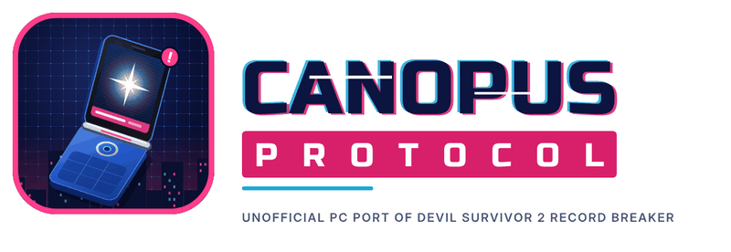

<p align="center">
  
</p>

# Canopus Protocol

An unofficial PC port of Devil Survivor 2 Record Breaker: a native Windows and Linux version of *Shin Megami Tensei: Devil Survivor 2
Record Breaker* (Nintendo 3DS), made by static recompilation. The game's ARM
code is translated to C on your machine and built together with a runtime
that does what the 3DS did: its kernel, system services, GPU (a software
PICA200 renderer), DSP audio, window and input.

**This repository contains no game data and no game code.** You need a dump
of your own copy of the game. Everything made from it (the extracted data
and the generated C code) stays on your machine; don't publish `data/` or
`build/`.

## License

[](LICENSE)

## What you need

- A **decrypted** dump of the game, as `.3ds`, `.cci`, `.cia` or `.cxi`.
  Make one from your own console with GodMode9. The supported version is
  the North American release; the setup step checks this.
- Optional: the **v1.1 update** and the **DLC**, also as decrypted `.cia`
  files dumped from your console.
- [Go](https://go.dev/dl/) 1.21 or newer (runs the recompiler).
- `make` and a C/C++ compiler for the platform you're building for (below).
- About 3 GB of free disk space for the extracted game data.

## Where your dump goes

```
games/        <- put your .3ds / .cia here
data/         <- made by "make setup": code.bin, exheader.bin, romfs/, saves
build/gen/    <- made by "make recomp": the recompiled C code
build/<target>/ds2rb(.exe)  <- the game
```

Copy your dump into the `games/` folder. The file name doesn't matter.
If you have the update and the DLC, put their `.cia` files in `games/` too;
`make setup` recognizes each one (game, update, DLC) and installs them in
that order:

- The **update** replaces the game code with version 1.1. `make recomp`
  then recompiles 1.1 (it reads `data/version.txt`).
- The **DLC** (the six bonus battles: Macca Makes an Escape, Let the Demons
  Grow, Addonetarium, All Skills Must Go!, The Beginner's Brawl, Lost Demon
  Rescue) is extracted into `data/dlc/`. In the game, each battle arrives
  as a mail in the Download folder (X, then Mail, then Right twice to the
  Download tab) once the story opens that folder. Read a mail to the end
  and answer Yes to fight it.

If you add the update or DLC later, run `make setup` and build again (for
example `make setup linux`): the build notices the new game version and
recompiles by itself.
Saves work with both versions.

## Building

All commands run from the top folder of this repository.

```sh
make setup      # extracts your dump from games/ into data/
make recomp     # recompiles data/code.bin into build/gen/ (a few seconds)
make linux      # or: make windows, make windows-zig, make linux-compat
```

`make setup` and `make recomp` are only needed once. Compiling the game
takes a few minutes the first time; later builds only recompile what
changed. Run `make` on its own to see every target.

### Linux

Install a compiler, make, Go, and SDL2 (used for the window and sound,
loaded when the game starts):

```sh
# Debian / Ubuntu
sudo apt install build-essential golang libsdl2-2.0-0
# Fedora
sudo dnf install gcc-c++ make golang SDL2
# Arch
sudo pacman -S base-devel go sdl2
```

Then:

```sh
make setup recomp linux
make run
```

`make linux` builds `build/linux/ds2rb` with your system's gcc.
`make linux-compat` builds `build/linux-compat/ds2rb` with Zig instead; that
binary runs on any Linux with glibc 2.28 or newer (2018 onwards), handy for
building once and playing on another machine. It needs Zig: either `zig` on
your PATH, or `pip install ziglang`.

### Windows

The Windows build is made with a cross compiler. Two ways:

**From WSL (Ubuntu) or any Linux, with MinGW-w64.** Recommended.

```sh
sudo apt install build-essential golang g++-mingw-w64-x86-64
make setup recomp windows
```

This builds `build/windows/ds2rb.exe`. The Makefile uses the *win32* thread
model compiler (`x86_64-w64-mingw32-g++-win32`). The posix one makes the
game hang, so don't swap it.

**With Zig (works from Windows itself, Linux or macOS).** Install Zig
([ziglang.org](https://ziglang.org/download/) or `pip install ziglang`), Go,
and `make` (for example from [MSYS2](https://www.msys2.org/):
`pacman -S make`). Then, in the MSYS2 shell:

```sh
make setup recomp windows-zig
```

This builds `build/windows-zig/ds2rb.exe`. Don't build the Windows version
with MSYS2's own gcc: it uses posix threads, which make the game hang.

## Playing

The game looks for its data in a `data` folder in the current directory,
or wherever `--data` points:

```sh
build/linux/ds2rb --data data          # Linux (or: make run)
build\windows\ds2rb.exe --data data    # Windows, from this folder
```

On Windows, `run.bat` in this folder starts whichever build you made.
`run.sh` does the same on Linux. To play from somewhere else, copy the
`.exe` and pass the full path of `data` with `--data`.

### Controls

| 3DS | Keyboard |
| --- | --- |
| +Control Pad | Arrow keys |
| A / B | X / Z |
| X / Y | S / A |
| L / R | Q / W |
| START / SELECT | Enter / Backspace |
| Circle Pad | I J K L |
| Touch screen | Left mouse button on the bottom screen |

| Cheat menu | F1 |

### Display options

The picture is drawn with vsync (in step with your monitor's refresh), so
it doesn't tear. On Windows it goes through OpenGL, or GDI if there is no
OpenGL driver; on Linux through SDL's accelerated renderer (normally
OpenGL). Add these after `--data data`, or to the line in `run.bat` /
`run.sh`:

| Option | Effect |
| --- | --- |
| `--no-vsync` | don't wait for the monitor (may tear; a little less input lag) |
| `--smooth` | smooth (bilinear) scaling instead of sharp pixels |
| `--output gdi` | Windows: draw with GDI instead of OpenGL |
| `--output software` | Linux: SDL's software renderer |

`ds2rb.log` says which output is in use (the `window: output:` line).
The game's 3D is still drawn on the CPU; only the final picture goes
through the graphics card.

Saves are kept in `data/save/`. The window can be resized. The title bar
shows the frame rate and how busy the renderer is.

### Cheat menu

Press **F1** in the game to open the cheat menu over the top screen (the
game pauses its input while it's open). Arrow keys move, Enter chooses,
Esc goes back, F1 closes it; in lists you can type to search and use
Page Up / Page Down to jump.

| Item | What it does |
| --- | --- |
| Max Macca | sets your money to 999,999 |
| Add a demon | any demon, at any level from its base level to 99, into a free stock slot (also registered in the compendium) |
| Party and stock | per member or demon: level 99, all stats 40, or both; max Fate |
| Learn skills | unlock any command, auto or racial skill for inheritance, one by one or all at once. This covers everything add-ons and cracking give you, since in this game add-ons are skills |
| Max Fate with everyone | Fate level 5 with every character |
| Fill the compendium | registers every demon |

Changes are made in memory; **save in the game** to keep them. The menu
is meant to be used outside battles and cutscenes (on the map or in a
menu).

### If something goes wrong

The game writes `ds2rb.log` in the folder it runs from. It records sound
dropouts, stalls (`hitch` and `no new picture` lines), a frame-rate line
every 10 seconds and, on a crash, the registers and stack. Include it when
reporting a problem.

If the game stops at start-up with "code.bin ... is not the code this build
was recompiled from", the game data changed after the last recompile (for
example the update was installed with an older copy of this Makefile).
Run `make recomp` and build again.

Options for testing: `-v` logs more, `--headless` runs without a window.
Environment variables used for debugging:

| Variable | Effect |
| --- | --- |
| `DS2RB_INPUT` | scripted input, e.g. `2000:START;2600:UP;2700-40000/90:A` |
| `DS2RB_DUMP=n` | write both screens to `frames/` every n frames |
| `DS2RB_WAV=file` | also write the sound to a WAV file |
| `DS2RB_SPEED=x` | run the game's clock x times faster |
| `DS2RB_TRACE=s` | log every system call after s seconds |
| `DS2RB_GPU_SYNC` | make the renderer synchronous |

## Player downloads

`make package` builds the downloads for players who don't want to build
anything: `build/dist/CanopusProtocol-windows-x64.zip` and
`build/dist/CanopusProtocol-linux-x64.tar.gz` (or `make package-windows`,
`make package-linux`). It needs Go, Zig (yours, from the PATH or
`ZIG=/path/to/zig`) and zip/tar, on Linux, WSL or MSYS2. The download
bundles Zig for the player's platform, the same version as yours: your own
installation for your platform, and for the other one the official build
from ziglang.org (downloaded with curl), or an unpacked copy you point to
with `ZIG_WINDOWS=<folder>` / `ZIG_LINUX=<folder>`.

A download contains **no game**: the launcher (`Canopus Protocol.exe`, or
`canopus-protocol` on Linux, with the icon), the setup tool, the
recompiler, the runtime as a prebuilt library, and Zig as the C compiler.
The player puts their dump (and the update and DLC, if they have them) in
its `games` folder and starts it. The first time, the launcher extracts
the dump, recompiles it and compiles the result with Zig on the player's
machine (a few minutes, with a progress window), then starts the game;
after that it starts at once, and it rebuilds by itself when the files in
`games` change. `packaging/README-player.txt` is the guide that ships
with it; `launcher/launcher.cpp` is the launcher.

The runtime library is built with your Zig and the player's machine links
it with the bundled one's C++ library, which is why the versions must match
(the script checks).

## How it works

| Folder | What's in it |
| --- | --- |
| `setup/` | `ds2rb_setup`: reads decrypted 3DS containers (NCSD, CIA, NCCH), checks the game version and extracts `code.bin`, the RomFS, the update's code and the DLC contents. |
| `recomp/` | The static recompiler (Go). It decodes ARMv6K/Thumb/VFPv2, discovers functions (with `functions.csv`, a table of addresses, names and sizes from the reverse engineering, and `hints.txt`) and writes one C function per game function. `functions_v11.csv` and `hints_v11.txt` are the same tables for version 1.1. `recomp/runtime/recomp.h` is the header the generated code is compiled with. |
| `launcher/`, `packaging/` | The player launcher and the scripts that build the downloads. |
| `branding/` | The icon and logos (SVG); `runtime/res` has the Windows icon. |
| `runtime/` | The C++ runtime: a kernel with guest threads, synchronization and timers (`kernel.cpp`), IPC services such as fs, gsp, dsp, apt, hid, cfg, y2r and am (`svc_*.cpp`; am and fs serve the DLC), the PICA200 GPU (`pica*.cpp`), DSP audio mixing, the window and input for Win32 and SDL2, patches for the hand-written ARM the recompiler can't express (coroutines in `patches.cpp`), and the cheat menu (`cheats.cpp`). |

## Status

The game boots, plays the opening movie with sound, and gets through New
Game, the prologue and registration, loads saves, and runs version 1.0 or
1.1 with the DLC. Known gaps: the game's 3D is drawn on the CPU
(on all cores), not the graphics card; no fragment lighting, and some
bottom-screen text (load and difficulty screens) draws garbled.
